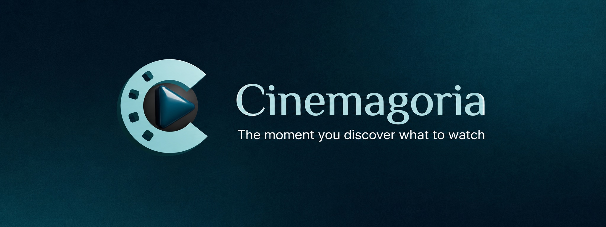
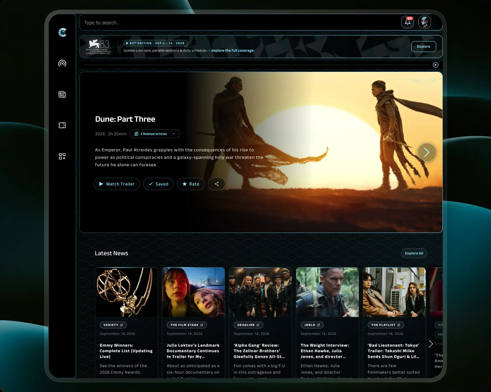
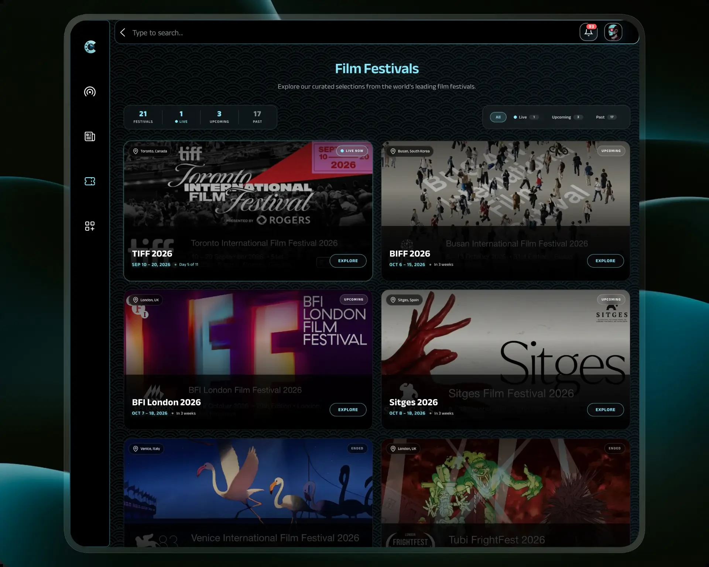
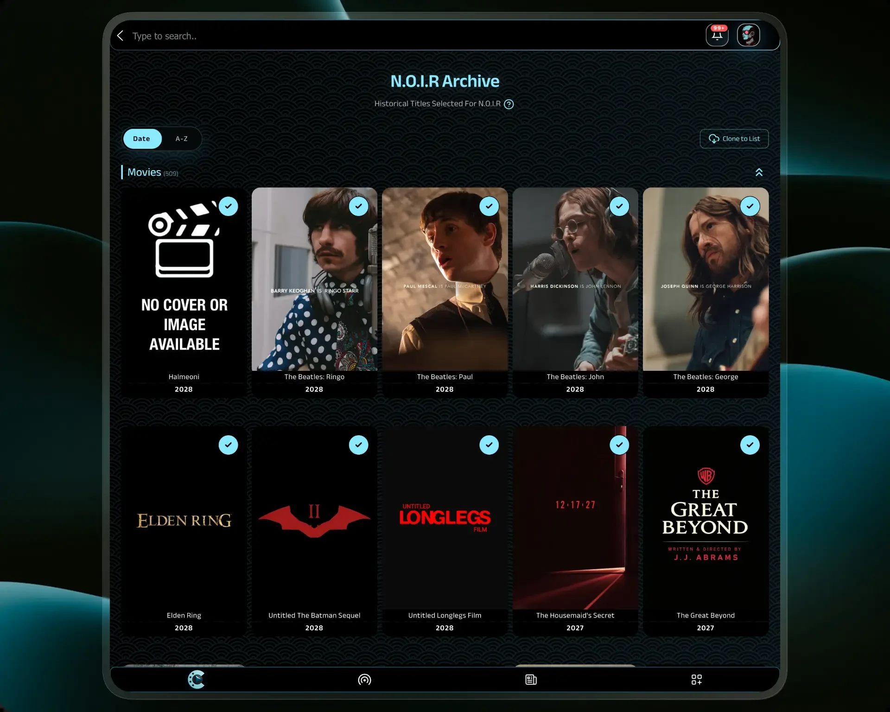
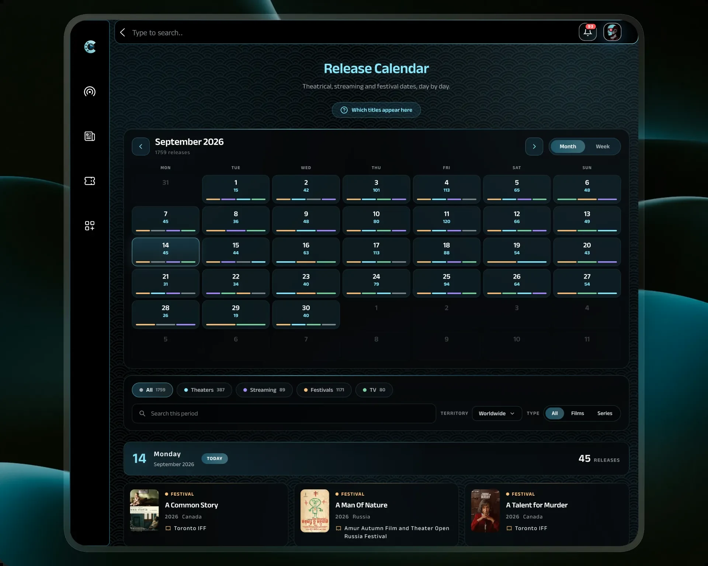
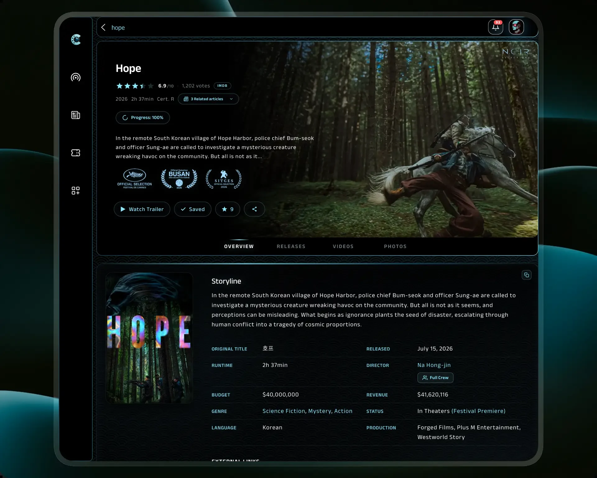
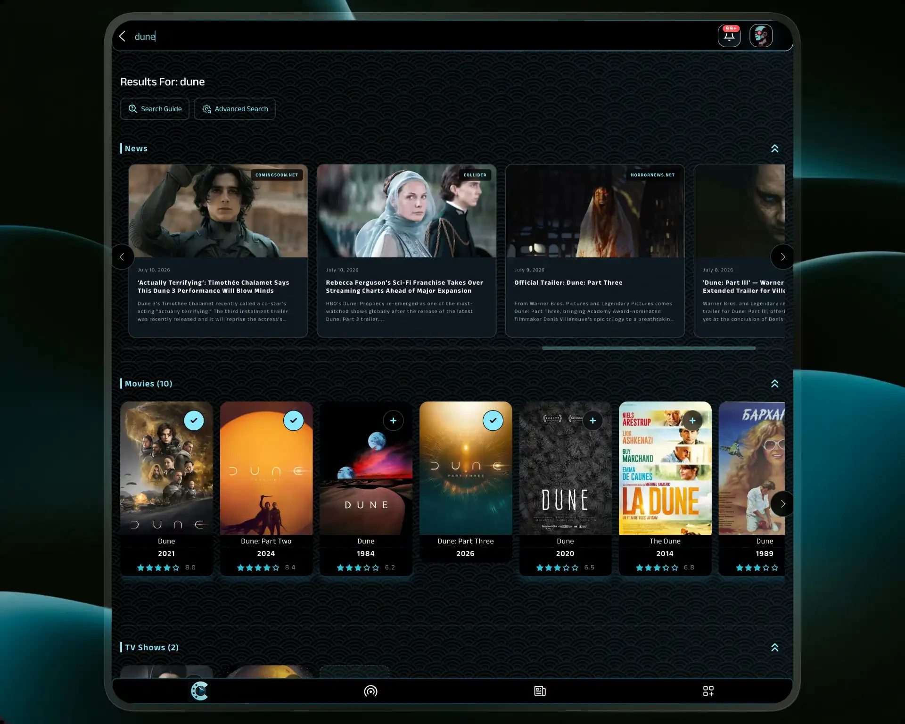
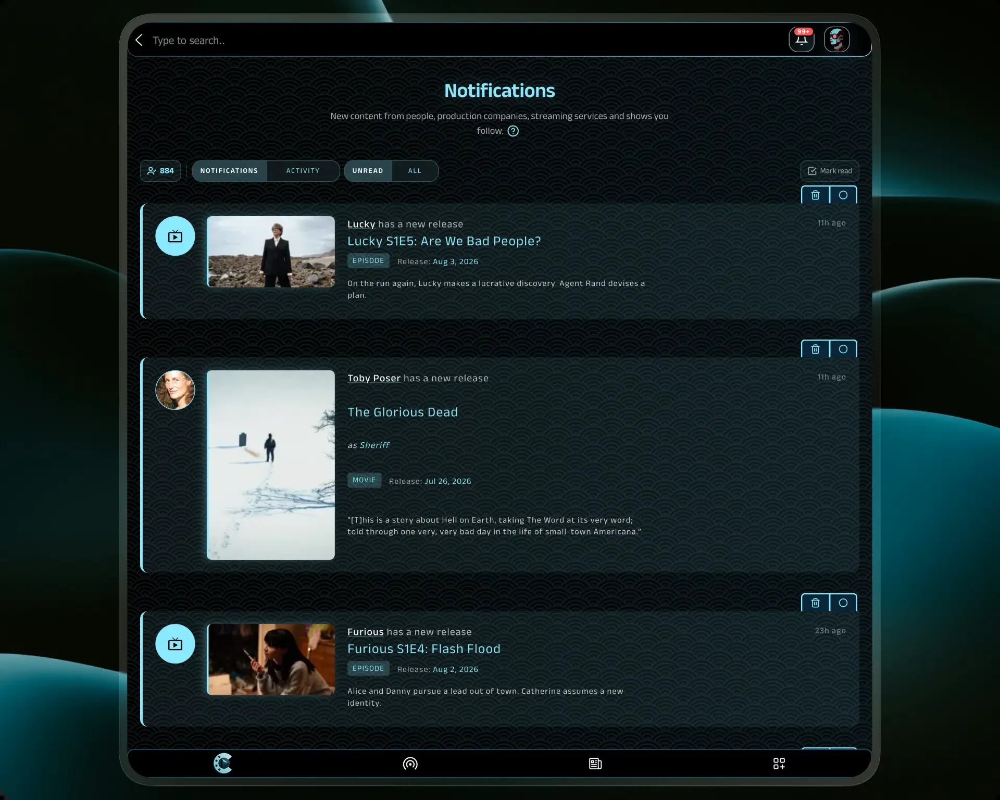

<div align="center">



### A community-oriented film & TV discovery platform.

[](https://github.com/cinemagoria/cinemagoria/releases/latest)
[](https://github.com/cinemagoria/cinemagoria/commits)
[](https://cinemagoria.com)

[**Website**](https://cinemagoria.com) · [**En español**](https://es.cinemagoria.com) · [**Changelog**](https://cinemagoria.com/changelog) · [**Roadmap**](https://github.com/orgs/cinemagoria/projects/1) · [**Report an issue**](https://github.com/cinemagoria/cinemagoria/issues/new)

</div>

<br>

The platform aggregates metadata, ratings, reviews, festival coverage, awards history, streaming availability and soundtracks from **IMDb, TMDB, Trakt, Rotten Tomatoes, JustWatch, MDBList and MusicBrainz**, with user accounts, custom lists and follow-based notifications.



## Principles

- **Aggregation over exclusivity** — no in-house catalog; data comes from trusted third-party sources.
- **Festival-first discovery** — every covered festival has its own hub with lineup, schedule and winners.
- **Editorial curation** — N.O.I.R. and first-party news and reviews sit alongside the algorithmic feeds.
- **Open access** — festivals, the release calendar and the N.O.I.R. archive need no account; accounts are free.

## Features

| | |
|---|---|
| **Festival hubs** | Lineups grouped by official section, searchable schedules in the reader's timezone, and winners archived as each ceremony closes. |
| **N.O.I.R.** | The platform's editorial selection: featured in the homepage marquee, then kept in a public archive, with a dated ledger of every featured title. |
| **Release calendar** | Every tracked release by month or week, each date tied to its country and release format. |
| **Search** | Unified search across films, series, people, news, festivals and production companies, with query parsing, typo detection and IMDb / TMDB ID lookup. |
| **Movie & TV pages** | IMDb-first ratings, Rotten Tomatoes, Trakt reviews, soundtracks, awards, full crew, trailers and streaming availability. |
| **Awards** | The major ceremonies and every covered festival, browsable by title and by person. |
| **News & reviews** | First-party articles and reviews alongside trusted outlets, with topics, related titles and an RSS feed. |
| **Lists & watchlist** | Unlimited public or private lists, personal ratings, and viewing progress by minute for films and by episode for series. |
| **Follows & notifications** | Follow people, series, production companies and streaming services, and get notified of new releases and episodes. |

<table>
  <tr>
    <td width="50%" align="center"><br><sub>Festival hubs</sub></td>
    <td width="50%" align="center"><br><sub>N.O.I.R.</sub></td>
  </tr>
  <tr>
    <td align="center"><br><sub>Release calendar</sub></td>
    <td align="center"><br><sub>Movie & TV pages</sub></td>
  </tr>
  <tr>
    <td align="center"><br><sub>Search</sub></td>
    <td align="center"><br><sub>Notifications</sub></td>
  </tr>
</table>

## Platform

- **Devices** — phones, desktops and TVs, with a lite mode for TV screens and low-memory devices.
- **Installable** as a web app from the browser.
- **Languages** — English and Spanish.
- **Seasonal programmes** alongside the regular catalog.
- **News sources** — every item is labeled with its source; AI-assisted articles include a disclosure and a form to report errors.
- **Privacy** — granular cookie consent, private profiles and self-service account deletion.

## Architecture

- **Precomputed data** — workers prepare news, festival, awards and spotlight data ahead of time; pages read results instead of computing them.
- **Edge caching** — home, movie and TV routes are served from the CDN.
- **Render budget** — the homepage renders within a time limit and the browser fills in anything that arrives late.
- **Query timeouts and profiling** — every database query has a timeout and is profiled by shape.
- **Data sync without deploys** — scheduled workflows sync editorial selections, enrichment and overrides to the database.

## Stack

| | |
|---|---|
| **App** | Nuxt · Vue 3 · Pinia · SCSS |
| **Data** | Turso (LibSQL) |
| **Auth** | Google OAuth · Django REST Framework |
| **Workers** | TypeScript · Rust · GitHub Actions |
| **Infrastructure** | Google Cloud · CDN edge caching |

## Setup

```bash
git clone https://github.com/cinemagoria/cinemagoria.git
cd cinemagoria
yarn install
yarn dev
```

Add a `.env` with the keys listed under `runtimeConfig` in `nuxt.config.ts`. Configuration is read only through `useRuntimeConfig()`.

<br>

<div align="center">

<sub>Built for film enthusiasts, by film enthusiasts · Led by <a href="https://github.com/imprvhub">@imprvhub</a> · <a href="https://cinemagoria.com/usage-policies">Usage policies</a></sub>

</div>
