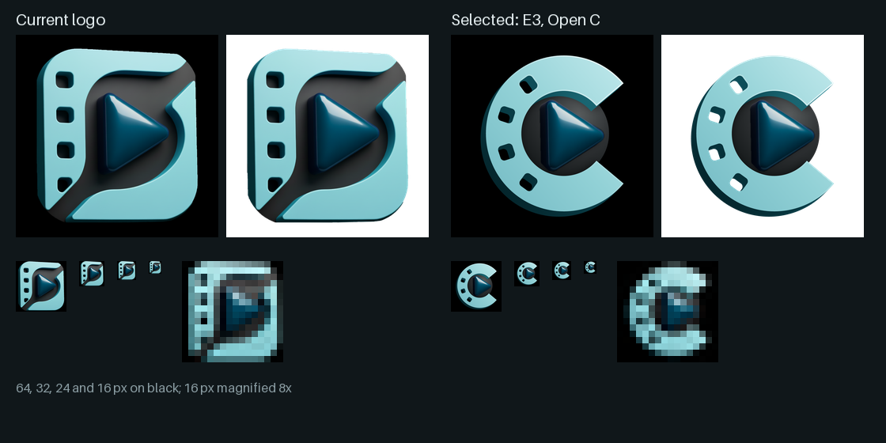

# Logo reformulation

Tracking issue: #597.

The logo existed only as a 512 px raster of a 3D render, with no vector master. Its square tile sat awkwardly in the circular slots where it appears most (favicons, the mobile bottom navigation, avatars), and its navy play button met the charcoal band at about 1.1:1 contrast, so it vanished at nav size. The reformulation keeps the logo's materials and changes its shape.

## How the mark was chosen

Every round was built as a preview page that shows each mark next to the current logo in the favicon, the mobile bottom navigation and the desktop sidebar.

1. **Audit.** The current logo was located, measured and reconstructed: sizes, colours, geometry and every place it is used.
2. **New concepts.** Twelve unrelated concepts across geometric, editorial, abstract and typographic directions. None was kept.
3. **Evolutions of the current logo.** Twelve variations in four families (refinement, circular, distinctive, system). The film strip bent into a C around the play button was kept as the direction.
4. **The C with the original materials.** Three versions with relief, the matte gray recess and the play button: [analysis.html](logo-reformulation/analysis.html), a self-contained page with every image embedded. GitHub shows it as source; download it or open it from a clone.

## Selected: E3, Open C

The film strip bends into a C with cyan face, teal side walls and sprocket holes. The matte gray recess sits only inside the C, so the silhouette is the C itself. The play button is the one from the current logo, cut pixel for pixel; it is the same play as version E1, which proved sharper and lighter at small sizes than the vector redraw in E2.

| | |
|---|---|
| Kept | The play button, its gloss and side wall; the matte gray recess; the cyan face, teal walls and sprocket holes |
| Changed | Film strip bent into a C; gray limited to the inside of the C |
| Removed | The rounded tile and the diagonal band |

## Masters

| File | Use |
|---|---|
| `logo-e3.svg` | Master. The C, its relief and the gray recess are vector; the play button is embedded as an image |
| `logo-e3-1024.png` | Transparent background. Source for every standard icon |
| `logo-e3-circle-1024.png` | On a black disc. Source for the circular favicons |
| `logo-e3-maskable-1024.png` | Full black square with the mark inside the 80% safe zone. Source for the maskable manifest icon and the Apple touch icons |

The content of every master is centred in its canvas (98/99 px side margins and 46/46 px top and bottom at 1,024 px).

## Production assets

Every file is replaced at the same path, size and format, so no reference changes. Paths are relative to `public/` unless noted.

| Source | Files |
|---|---|
| Transparent | `icon.png` (512), `icons/icon-medium.png` (180), `icons/favicon-{32,36,48,57,60,72,76,96,192}.png`, `icons/icon-512x512.webp` (512), `favicon.ico` (16/32/48), `icons/favicon.ico` (16/32), `assets/images/favicon-32.png` (repository root) |
| Circle | `icons/favicon-circle-{48,96,192}.png` |
| Maskable | `icons/icon-192x192.png` (192), `icons/favicon-{72,114,120,144,152,180}-precomposed.png` |
| Composed | `og-image.jpg` (1200×630, mark with wordmark and tagline) |

The editorial tooling's admin panel holds its own copies of `favicon.ico`, `favicon-32.png`, `favicon-96.png`, `favicon-192.png` and `favicon-180-precomposed.png`. The feed scripts and the old-domain redirect page load the icons by URL and follow the new files without changes.

## Limits

- The play button comes from the 512 px export, so it softens above about 1,024 px. Cutting it again from the 1,024 px design file would remove that limit.
- Relief and gloss cannot be printed in one ink; single-colour uses fall back to the flat C.
